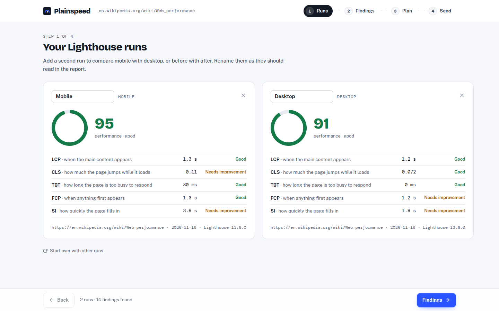
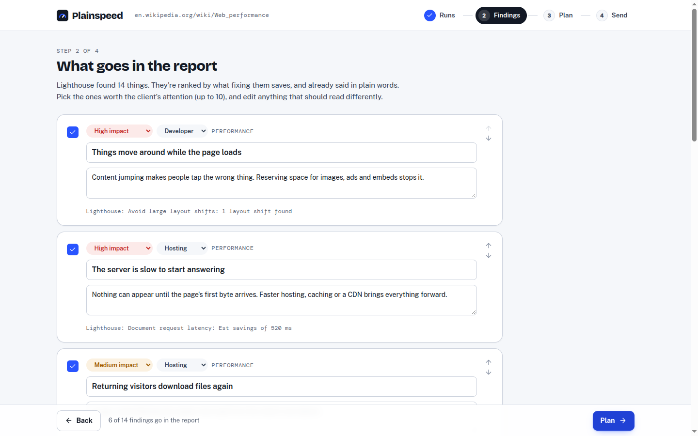
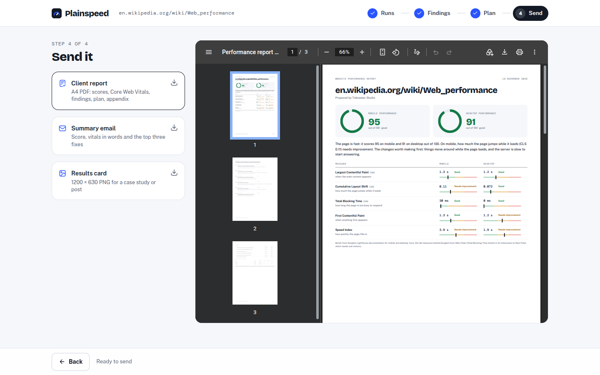
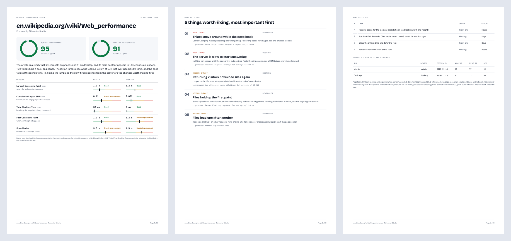
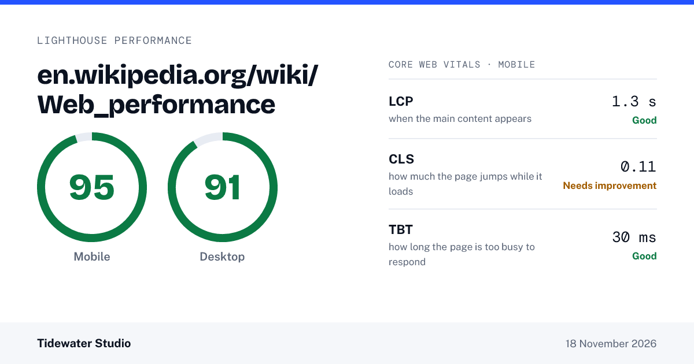
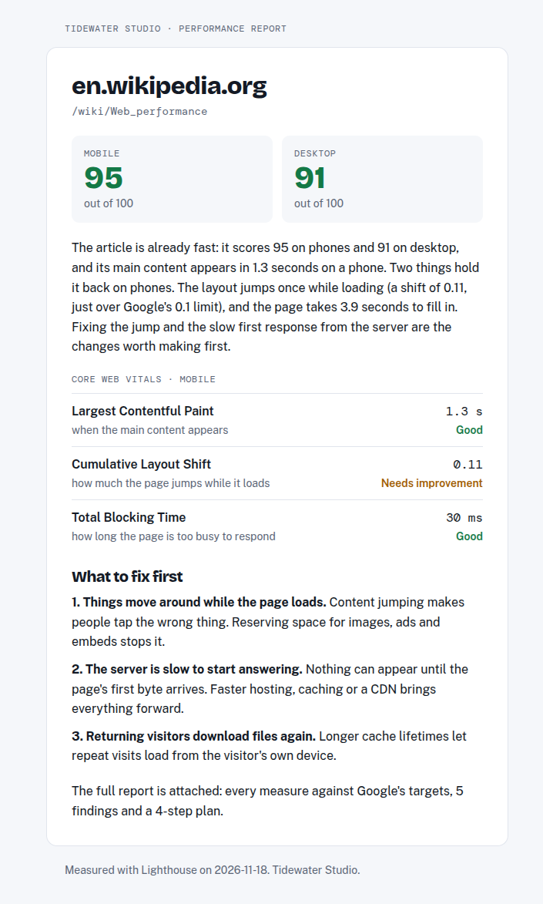

# Plainspeed

**Lighthouse, in words your client reads.** Drop one or two Lighthouse JSON reports. Plainspeed rates every metric
against Google's bands, ranks what's worth fixing, says each finding in plain English, and writes three things you can
send: a client report (PDF), a summary email, and a results card (PNG).

Built with [Hyper Elements](https://github.com/hyper-elements/hyper-elements) for the Hyper Elements Template Challenge.



## Why this exists

Freelancers and agencies run Lighthouse for clients, and then have to explain it.

> "Most audit tools give you a wall of Lighthouse data but that is useless when you're trying to explain issues to a
> client." ([r/webdev, March 2026](https://www.reddit.com/r/webdev/comments/1s5v36q/))

Clients care because Google does: good Core Web Vitals align with what Google's "core ranking systems seek to reward"
([Search Central](https://developers.google.com/search/docs/appearance/core-web-vitals)).

Lighthouse says *"Document request latency: Est savings of 520 ms"*. Plainspeed says *"The server is slow to start
answering. Nothing can appear until the page's first byte arrives. Faster hosting, caching or a CDN brings everything
forward."*

**Why a file and not the API:** the keyless PageSpeed Insights API answered `429 Quota exceeded … Queries per day` when
we tried it. Every developer can save a Lighthouse JSON (DevTools → Lighthouse → ⋮ → Save as JSON, or
`npx lighthouse <url> --output=json`), with no key.

## The four steps

| Step | What happens |
|---|---|
| **1 Runs** | Drop one or two runs: mobile and desktop, or before and after. Runs of different pages are refused. Each metric is rated against the band for its device. |
| **2 Findings** | Failing audits ranked by what fixing them saves (Lighthouse's own estimates). Each one is written in plain words, with who usually fixes it. Pick up to 10, reorder them, edit any word. |
| **3 Plan** | A summary drafted only from the numbers, plus a plan of tasks with owners and effort. You make it sound like you. |
| **4 Send** | Preview and download the PDF, the email and the card. |





The sample report (three A4 pages):



| Results card | Summary email |
|---|---|
|  |  |

The landing page (7 sections, with an FAQ): [media/landing.png](media/landing.png).

## The bands

Taken from Google's Lighthouse docs (LCP, TBT, FCP, Speed Index) and web.dev (CLS), for the device each run used:

| Measure | Mobile good / poor past | Desktop good / poor past |
|---|---|---|
| Largest Contentful Paint | 2.5 s / 4 s | 1.2 s / 2.4 s |
| Cumulative Layout Shift | 0.1 / 0.25 | 0.1 / 0.25 |
| Total Blocking Time | 200 ms / 600 ms | 150 ms / 350 ms |
| First Contentful Paint | 1.8 s / 3 s | 0.9 s / 1.6 s |
| Speed Index | 3.4 s / 5.8 s | 1.3 s / 2.3 s |

A lab test can't measure Interaction to Next Paint, so the report shows Total Blocking Time as its lab stand-in, and
says so.

## How Hyper Elements is used

The three outputs are **Hyper Elements templates** in `templates/`. The app renders them in a route handler
(`src/app/api/render/route.ts`), and the CLI renders the same files.

- **Typed fields with rules** (`templates/_shared/report.tsx`). Scores are whole numbers from 0 to 100, metrics are
  non-negative numbers, the site must be an `http(s)` URL, there are 1 or 2 runs, at most 10 findings and 10 tasks, and
  the summary is at most 700 characters. A value outside the rules stops the render with the field and the reason.
- **`<Document>` + `renderPdf()`** for the report. Page 1 has the score rings and the metric table, where each value
  sits on its band, drawn with `Svg` and `Rect`. Findings are split 7 to a page between `PageBreak`s, then the plan and
  the appendix, with a `PageFooter` and `PageNumber`.
- **`<Canvas>` + `renderImage()`** for the card. The score sits inside its ring using a `Layer`. `fit` shrinks the URL
  until it fits. The card requires the `image/overflow`, `image/glyph` and `image/fit` rules.
- **`<Email>`** with a `defineTheme()` theme (display headings, named styles), checked by lint (`contrast`,
  `link-text`, `lang`) and the email client checks.
- **One ring, three outputs.** The score ring is a single `Svg` arc component. It's vector in the PDF and pixels on
  the card.
- **Values files + CLI:** `npm run reports` renders `reports/wikipedia-web-performance.json` with `hyper-elements
  design new` and `hyper-elements render`.

## Run it

Needs Node 22.6+.

```bash
npm install
npm run dev            # http://localhost:3000 (landing) and /report (the dashboard)
```

In the dashboard, drop your own Lighthouse JSON, or press **Load the sample runs**.

```bash
npm test               # the Lighthouse reader, the bands, the draft (8 tests on the real sample runs)
npm run check          # check the three templates with their example
npm run reports        # reports/wikipedia-web-performance.json → out/reports/ (PDF, email, card)
npm run preview:email  # the email as Outlook, Gmail and Apple Mail show it
npm run build && npm start
```

## Project layout

```
templates/_shared/metrics.ts  the five lab metrics, Google's bands per device, formatting (no imports)
templates/_shared/plain.ts    49 Lighthouse audits in plain English, who fixes them, and the task that fixes them
templates/_shared/report.tsx  the report's fields, look and score ring
templates/_shared/example.ts  the sample: two real Lighthouse 13.6.0 runs, written up by a made-up studio
templates/report.tsx          <Document>: the client report
templates/email.tsx           <Email>: the summary
templates/card.tsx            <Canvas>: the results card
src/lib/lighthouse.ts         reads Lighthouse JSON (also a PageSpeed Insights response) and ranks the findings
src/lib/draft.ts              findings, plan and summary drafts, and the values the templates take
src/components/Dashboard.tsx  the four-step dashboard
public/samples/               the two real runs (screenshots stripped to keep them small)
tests/                        reader, bands and draft tests
```

## Sample data

The two Lighthouse runs are real. We ran Lighthouse 13.6.0 on
https://en.wikipedia.org/wiki/Web_performance (mobile and desktop) on 18 November 2026, and removed the embedded
screenshots. "Tidewater Studio", which signs the sample report, is made up.

## License

MIT for the code. Fonts: Bricolage Grotesque, Public Sans and DM Mono, SIL Open Font License 1.1 (`fonts/OFL-*.txt`).
